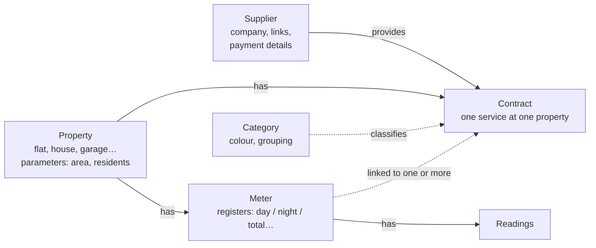

# Home utilities — user guide

*Русская версия: [ru.md](ru.md).* This guide describes what the app can do **now**. Features that are still being
built are listed at the end.

<!-- Maintained by coding sessions: every task that changes what the user sees updates this file AND ru.md
     in the same PR. Use the exact UI wording from AppResources.resx. Examples must be invented. -->

## 1. How things fit together

The app is built around a few kinds of records. Most confusion comes from not knowing which record holds which
information, so start here.

| Record | What it is | Example |
|---|---|---|
| **Property** | A place you pay for: apartment, house, cottage, garage, land. Holds **parameters** that change over time (total area, declared residents…). | "Flat in town", 52.3 m², 2 residents |
| **Supplier** | A company you pay. Holds website links (portal, pay online, submit readings) and default **payment details** (IBAN, purpose template). One supplier can serve many properties. | "City Water Ltd" |
| **Contract** | One service from one supplier **at one property**: service kind, category, customer/contract number, billing mode and timing, reading window. Can override the supplier's payment details and links. | "Water — Flat in town" with City Water Ltd |
| **Meter** | A physical meter **in a property**, with one or more **registers** (Total, or Day/Night, Export for solar). | Cold water meter in the bathroom |
| **Meter ↔ contract link** | Says which contracts use a meter. One meter can be used by several contracts. | The hot water meter is linked to the **water** contract (water volume) **and** the **heating** contract (water heating). |
| **Reading** | A value of a meter register on a date. Consumption is calculated from readings. | 01.10.2026: 1234.567 m³ |
| **Category** | Your own grouping with a colour for reports (e.g. "Water", "Taxes"). Every contract has one. | "Water", blue |

**Order of setting things up:** properties → suppliers → contracts (in the property) → meters (in the property,
linked to contracts) → readings. You can add a supplier directly from the contract editor ("＋ New supplier…").

## 2. Screens and common behaviour

**Menu:** Overview, Properties, Suppliers, Readings, Bills, Payments, Reports, Settings. On a phone the menu opens
with ☰; on a wide window it is always visible.

**Layout:** on a phone a list opens the editor as a separate page. On a tablet or a wide window the list is on the
left and the editor on the right. Settings shows the current layout (phone / tablet / desktop).

**Saving and leaving**
- ✓ / **Save** saves and **keeps you in the editor**. Only **Back** leaves.
- Leaving with unsaved changes asks **Save changes?** — *Save*, *Don't save* or *Cancel* (stay where you are).
  This also applies when you pick another item in the menu, use the Android back gesture, or close the Windows window.
  If *Save* finds a mistake in the form, you stay and see the red message.
- A menu item always opens the **main screen of its section** (the list), never a half-finished editor you left earlier.
  On a wide window the list opens with the previously selected record and its editor on the right.
- **Delete** hides the record; its history is kept. Many records can instead be **archived** — hidden from lists and
  pickers but still used in history. Use "Show archived" to see them again.
- Fields marked * are required. A wrong value shows a red message under the field; the app does not save until
  it is fixed.
- Numbers accept both `,` and `.` as the decimal separator.

**Child rows** (parameters, links, registers, custom fields…): the card header has ＋ to add; tap a row to edit it
in a dialog; the trash icon deletes it (with confirmation).

## 3. Properties

Menu **Properties** → **New property**.
- **General:** name, kind (apartment, house, cottage, garage, land, other), address, notes, archived.
- **Parameters:** values that tariffs can use — total area, heated area, land area, declared residents, cadastral
  values, or a custom parameter. Each value has a **Valid from** date; when the area or the number of residents
  changes, add a new value instead of overwriting the old one, so older periods are still calculated correctly.
  The row shows "Now: … since …"; the history button shows earlier values.
- **Contracts** and **Meters** cards: the property's contracts and meters (save the property first).

## 4. Suppliers

Menu **Suppliers** → **New supplier**.
- **General:** name, registration number, phone, e-mail, notes. Search by name in the list.
- **Links:** websites with a kind — *Website*, *Customer portal*, *Pay online*, *Submit readings*, *Tariffs*, *Other*.
  The open icon opens the link in your browser. **Passwords are not stored** — let your browser remember them.
- **Payment details:** recipient, registration number, bank, BIC, IBAN and a **payment purpose template**.
  Placeholders in the template are replaced with real data: `{CustomerNumber}`, `{ContractNumber}`, `{BillNumber}`,
  `{Period:MM.yyyy}`, `{Amount}`, `{PropertyName}`. Example: `Customer {CustomerNumber}, {Period:MM.yyyy}` →
  "Customer 100200, 10.2026". Copy buttons put the IBAN, recipient or purpose on the clipboard for your bank app.

## 5. Contracts

Open a property → card **Contracts** → **Add contract**.
- **General:** title, supplier, service kind (water, heating, electricity, waste, internet, tax…), category, valid
  from / to, archived.
- **Account:** customer number, contract number, portal login (no password).
- **Billing:**
  - *Billing mode* — **By consumption** (meters), **Fixed fee**, **Equalized payments** (the same amount every month,
    settled once a year), **Tax (annual amount)**.
  - *Billing timing* — **In arrears** (the bill comes after the month of service: water, electricity) or
    **In advance** (paid before the month: internet, TV).
  - Usual bill day, payment due day, currency.
- **Reading submission window:** the days of the month when the supplier accepts readings, e.g. 25–28. A window
  like 28–3 continues into the next month. The Readings screen uses it to show "open now / opens in N days".
- **Payment details / Links:** leave a field empty to use the supplier's value. "Effective payment details" shows
  the result, including the payment purpose filled with this contract's numbers.
- **Custom fields:** extra fields (text, number, amount, date) that will appear when you enter a bill or a bill line
  for this contract.

## 6. Meters

Open a property → card **Meters** → **Add meter**.
- **General:** resource (cold/hot water, electricity, gas, heat, other), unit (m³, kWh, MWh, Gcal), serial number,
  location, notes, **photo** (camera on Android, image file on Windows).
- **Dial digits:** how many digits the dial has. Needed to recognise a roll-over (99999 → 00000).
- **Registers:** *Total* for ordinary meters; *Day* and *Night* (or the "Dual tariff" switch) for two-rate
  electricity meters; *Export* counts energy fed into the grid (solar panels).
- **Installation and verification:** installed on, last verified, verification interval (water meters usually 72
  months) → the app shows "Next verification" and warns when it is overdue.
- **Contracts:** switch on every contract that uses this meter. A hot water meter is usually linked to both the
  water and the heating contract.
- **Readings:** the latest readings and "All readings". A *Submit readings* link of the contract or supplier is
  shown on the meter card.
- **Replace meter…** — use this when a meter is physically replaced (verification, defect). A wizard asks for the
  date, the final reading of the old meter, the new meter with its initial reading, and the contracts the new meter
  belongs to. The old meter is kept as removed ("Show removed"), so consumption across the change is correct.
  A meter that already has readings cannot be deleted — replace it instead.

## 7. Readings

Menu **Readings**: the fastest way to enter monthly values.
1. Choose the **property** and check the **reading date** (today by default).
2. Every active meter register has a field with the last value ("last: …"). Enter the new values; empty fields are
   skipped. **Save all** saves them together.
3. Warnings appear under a value but do not block saving: *Unusually high*, *Zero consumption*, *Roll-over assumed*,
   *The date is before the last reading*. A value lower than the last one on a meter without dial digits is an
   error.
4. The header shows each contract's reading window ("submit 25–28 — open now").
5. **Submit online** opens the supplier's *Submit readings* link. When you come back, the app asks **Readings
   submitted?** — *Mark submitted* stores the date, so you can see which readings were sent.

Tap a meter to see its reading history; tap a reading to edit it (date, value, kind, note, submitted). Initial and
final readings belong to a meter replacement and cannot be deleted.

## 8. Categories

**Settings → Categories.** Categories group contracts and payments in lists and reports and give them a colour.
Built-in categories can be renamed (leave the name empty to return to the default) and archived but not deleted;
you can add your own.

## 9. Settings

Language (English / Русский), theme (system / light / dark), categories, version, database file location, and the
**Error log**: if the app reports an error, use *Copy log* and send the text to the developer.

## 10. Coming soon

Tariffs and VAT rates per contract, calculated monthly charges, bills with the "Paid" quick action, payments and
balances, equalized-payment settlement and property tax installments, overview of what to do, reports and charts,
bill templates, Excel import, reminders, backup and Google Drive sync.
