# Коммунальные платежи — руководство пользователя

*English version: [en.md](en.md).* Здесь описано то, что приложение умеет **уже сейчас**. Функции, которые ещё
в работе, перечислены в конце.

<!-- Maintained by coding sessions: every task that changes what the user sees updates this file AND en.md
     in the same PR. Use the exact UI wording from AppResources.ru.resx. Examples must be invented. -->

## 1. Как всё связано

В приложении несколько видов записей. Чаще всего путаница возникает из-за того, что непонятно, какая запись хранит
какие сведения, поэтому начните с этого раздела.

| Запись | Что это | Пример |
|---|---|---|
| **Объект** | То, за что вы платите: квартира, дом, дача, гараж, земельный участок. Хранит **параметры**, меняющиеся со временем (общая площадь, заявленные жильцы…). | «Квартира в городе», 52,3 м², 2 жильца |
| **Поставщик** | Компания, которой вы платите. Хранит ссылки на сайт (личный кабинет, оплата онлайн, передача показаний) и **платёжные реквизиты** по умолчанию (IBAN, шаблон назначения). Один поставщик может обслуживать много объектов. | «Городская вода» |
| **Договор** | Одна услуга одного поставщика **на одном объекте**: вид услуги, категория, номер клиента и договора, способ и время расчёта, окно передачи показаний. Может заменять реквизиты и ссылки поставщика своими. | «Вода — квартира в городе» с «Городской водой» |
| **Счётчик** | Физический счётчик **в объекте** с одним или несколькими **регистрами** (Общий; День/Ночь; Отдача для солнечных панелей). | Счётчик холодной воды в ванной |
| **Привязка счётчика к договору** | Показывает, какие договоры используют счётчик. Один счётчик может участвовать в нескольких договорах. | Счётчик горячей воды привязан к договору **на воду** (объём воды) **и** к договору **на отопление** (подогрев воды). |
| **Показание** | Значение регистра счётчика на дату. Расход считается по показаниям. | 01.10.2026: 1234,567 м³ |
| **Категория** | Ваша группировка с цветом для отчётов (например, «Вода», «Налоги»). У каждого договора есть категория. | «Вода», синий |
| **Компонент тарифа** | Одна строка счёта по договору с ценами, меняющимися со временем, и ставкой НДС. Несколько компонентов образуют **тариф** договора. | «Водоснабжение» 1,41 €/м³ без НДС, «Канализация» 0,86 €/м³ без НДС |
| **Начисление** | Сколько договор должен стоить за месяц: расход по показаниям × цены тарифа, с НДС. Считается по запросу, не хранится. | Вода, октябрь: 5,500 м³ × 1,41 € = 7,76 € + НДС 21 % = 9,39 € |
| **Ставка НДС** | Именованный процент НДС, меняющийся со временем; компоненты тарифа ссылаются на него, поэтому изменение государственной ставки вводится один раз. | «Standard rate»: 21 % |
| **Счёт** | Сколько поставщик на самом деле выставил за месяц (или любой разовый расход без договора). Сравнивается с начислением, которое посчитало приложение. | Вода, октябрь: 46,02 €; приложение ожидало 45,10 € |
| **Шаблон счёта** | Как выглядит платёж *без счётчика* и когда он приходит (интернет, страховка, чистка дымохода, ежегодный взнос). По нему приложение создаёт **черновик** счёта за каждый месяц. См. [Шаблоны счетов и черновики](#шаблоны-счетов-и-черновики). | «Страховка дома»: раз в год в марте, 120,00 € |
| **Платёж** | Деньги, которые вы заплатили. Платёж относится к счёту — тогда счёт *Оплачен*; то, что не отнесено к счетам, остаётся на договоре как предоплата. | 03.11.2026: 46,02 € банковским переводом |

**Порядок заполнения:** объекты → поставщики → договоры (внутри объекта) → счётчики (внутри объекта, с привязкой к
договорам) → показания → счета. Затем каждый день начинайте с **Обзора**: он показывает, что делать дальше. **Тариф** (цены) договора вводите тогда, когда хотите, чтобы приложение считало, на какую
сумму должен быть счёт. Поставщика можно добавить прямо из редактора договора («＋ Новый поставщик…»).

## 2. Экраны и общие правила

**Меню:** Обзор, Объекты, Поставщики, Показания, Начисления, Счета, Платежи, Отчёты, Справка, Настройки. На телефоне меню открывается
кнопкой ☰, на широком окне оно видно всегда.

**Справка:** это руководство встроено в приложение, работает без интернета и показывается на языке приложения.
Открыть его можно в меню, пункт **Справка**. На экранах «Обзор», «Объекты», «Поставщики», «Показания», «Начисления», «Счета», «Платежи», «Отчёты», «Категории», «Ставки НДС», а также
в редакторах договора, счётчика и компонента тарифа в панели инструментов есть кнопка **?**: она открывает руководство на нужном
разделе, а **Назад** возвращает на экран.

**Расположение:** на телефоне редактор открывается отдельной страницей. На планшете и широком окне список слева,
редактор справа. В настройках показан текущий макет (телефон / планшет / компьютер).

**Сохранение и выход**
- ✓ / **Сохранить** сохраняет и **оставляет вас в редакторе**. Выйти можно только кнопкой **Назад**.
- Если есть несохранённые изменения, при выходе появится **Сохранить изменения?** — *Сохранить*, *Не сохранять* или
  *Отмена* (остаться на месте). То же самое происходит, если выбрать другой пункт меню, использовать жест «Назад»
  на Android или закрыть окно в Windows. Если при *Сохранить* в форме найдена ошибка, вы остаётесь на месте и видите
  красное сообщение.
- Пункт меню всегда открывает **главный экран раздела** (список), а не недоделанный редактор, из которого вы ушли.
  В широком окне список открывается с ранее выбранной записью и её редактором справа.
- **Удалить** скрывает запись, история сохраняется. Многие записи можно вместо этого **отправить в архив**: они
  скрываются из списков и выбора, но остаются в истории. Флажок «Показать архивные» снова показывает их.
- Поля со звёздочкой * обязательны. При неверном значении под полем появляется красное сообщение, и сохранить
  запись нельзя, пока оно не исправлено.
- В числах можно использовать и `,`, и `.` как десятичный разделитель.

**Короткие сообщения.** После *Сохранить* или *Копировать* внизу окна на несколько секунд появляется небольшая полоса
**Сохранено** или **Скопировано**. У некоторых сообщений есть кнопка, например **Счёт отмечен оплаченным · Отменить**
(такое сообщение висит чуть дольше). Полоса ничему не мешает — просто продолжайте работу.

**Вложенные строки** (параметры, ссылки, регистры, дополнительные поля…): ＋ в заголовке карточки добавляет строку;
нажатие на строку открывает её в диалоге; корзина удаляет (с подтверждением).

## Обзор

Пункт меню **Обзор** — стартовый экран: он открывается первым и отвечает на два вопроса — *что мне нужно сделать сейчас?* и
*как обстоят дела с деньгами?* Он ничего не хранит сам, а берёт данные из договоров, счётчиков, показаний, счетов и платежей,
поэтому он настолько точен, насколько полны эти данные. На телефоне экран обновляется движением вниз; кроме того, он
обновляется каждый раз, когда вы на него возвращаетесь, например после ввода показаний или счёта.

Если объектов несколько, вверху есть фильтр **Объект**: он ограничивает все три карточки одним объектом (или *Все объекты*);
приложение запоминает выбор. На телефоне карточки идут друг под другом; на планшете и в широком окне **Что сделать** слева, а
**Деньги** и **Этот год** справа. Кнопка **?** открывает этот раздел.

### Что сделать

Одна строка на каждое дело, по срочности: сначала просроченные (красные), затем сегодняшние, затем ближайшие (жёлтые), затем
справочные. Нажатие на строку открывает нужный экран; **Назад** возвращает в «Обзор», и если дело сделано, строки уже нет.

| Строка | Когда появляется | Когда исчезает | Нажатие / кнопка |
|---|---|---|---|
| **Передать показания: Вода, Отопление** | Окно показаний договора (задаётся в договоре, например 25–28) открыто, откроется в ближайшие 3 дня или закрылось меньше 4 дней назад — и ни у одного счётчика договора нет показания с датой внутри этого окна. Договоры с одним и тем же окном объединяются в одну строку. | Вы сохранили показание счётчика внутри окна либо прошло 3 дня после его закрытия. | Открывает **Показания** этого объекта на сегодня. |
| **Оплатить {договор} за {месяц}** (счёт; для налога — **Оплатить: Налог на недвижимость …**) | Неоплаченный счёт, срок оплаты которого наступит в ближайшие 7 дней, сегодня или уже прошёл. Сумма — то, что ещё не оплачено. | Счёт оплачен полностью. | Нажатие открывает счёт. Кнопка **Оплачено** (✓) отмечает остаток оплаченным сегодняшним числом и показывает **Счёт отмечен оплаченным · Отменить**; **Отменить** возвращает всё назад, и строка появляется снова. |
| **Счёт за {месяц} от «{договор}» ещё не внесён** | У договора указан *день счёта*, а счёта за ожидаемый месяц ещё нет: за **прошлый** месяц, если счета приходят после услуги, или за **следующий**, если договор оплачивается вперёд, — и сегодня не раньше дня счёта (в месяце после периода, а для предоплаты — в месяце перед ним). Налоговые договоры не проверяются. | Вы внесли счёт по этому договору и месяцу. | **Внести счёт** открывает новый счёт с уже выбранными договором и месяцем. |
| **Черновики счетов к подтверждению: 3** | Один или несколько **черновиков счетов**, созданных по вашим шаблонам счетов, ждут вас (одна строка на объект). Только информация. | Вы подтвердили или удалили черновики. | Открывает **Счета** этого объекта с фильтром **Черновики**. |
| **Поверка счётчика …** | У работающего счётчика поверка нужна в ближайшие 60 дней либо уже просрочена. | Дата поверки счётчика перенесена вперёд. | Открывает счётчик. |
| **Ожидаемый перерасчёт: {договор}** | По договору с равномерными платежами (см. «Равномерные платежи») ожидается перерасчёт от 1,00 € в любую сторону (доплата или возврат). Только информация. | Счёт-перерасчёт внесён либо сумма стала меньше 1,00 €. | Открывает страницу перерасчёта. |

Пороги (3 дня, 7 дней, 60 дней, 1,00 €) в этой версии заданы жёстко. Если делать нечего, вы увидите
**Делать нечего — показания переданы, счета оплачены.**

### Деньги

По каждому объекту: **Неоплаченные счета** (всё, что ещё не оплачено, — как на экране «Счета» со статусом *Неоплаченные*),
**Просрочено** (часть, срок оплаты которой прошёл), **Предоплата** (деньги, которые вы заплатили, но которые пока не отнесены ни к
одному счёту, — как на экране «Платежи») и **баланс** всех договоров объекта — **Долг …** красным или **Оплачено вперёд …**
зелёным; это сумма значений из карточек «Баланс» всех договоров. Договоры с равномерными платежами добавляют строку
**Ожидаемый перерасчёт, {договор}: доплата / возврат …**. Нажатие на строку открывает экран «Счета» (с фильтром по
неоплаченным или просроченным), экран «Платежи» или страницу перерасчёта.

### Этот год

По каждому объекту — сумма счетов этого года с НДС (по месяцу счёта) с января по текущий месяц рядом с теми же месяцами
прошлого года: *2026: 1 245,30 € · 2025 за тот же период: 1 180,10 € (+5,5 %)*. Счёт за более поздний месяц (например,
интернет, оплаченный вперёд) учитывается, когда этот месяц наступит. Нажатие открывает экран «Счета» за этот год. Графики на этом экране
появятся позже.

## 3. Объекты

Меню **Объекты** → **Новый объект**.
- **Основное:** название, тип (квартира, дом, дача, гараж, земельный участок, другое), адрес, заметки, архив.
- **Параметры:** значения, которые используют тарифы: общая, отапливаемая площадь, площадь участка, заявленные
  жильцы, кадастровая стоимость или свой параметр. У каждого значения есть дата **Действует с**. Когда площадь или
  число жильцов меняется, добавьте новое значение, а не исправляйте старое, — тогда прошлые периоды будут
  считаться правильно. Строка показывает «Сейчас: … с …», кнопка истории показывает прежние значения.
- Карточки **Договоры** и **Счётчики**: договоры и счётчики объекта (сначала сохраните объект).

## 4. Поставщики

Меню **Поставщики** → **Новый поставщик**.
- **Общее:** название, регистрационный номер, телефон, e-mail, заметки. В списке есть поиск по названию.
- **Ссылки:** адреса сайтов с типом — *Сайт*, *Личный кабинет*, *Оплата онлайн*, *Передача показаний*, *Тарифы*,
  *Другое*. Значок открытия открывает ссылку в браузере. **Пароли не сохраняются** — их запоминает ваш браузер.
- **Платёжные реквизиты:** получатель, регистрационный номер, банк, BIC, IBAN и **шаблон назначения платежа**.
  Подстановки в шаблоне заменяются настоящими данными: `{CustomerNumber}` (номер клиента), `{ContractNumber}`
  (номер договора), `{BillNumber}` (номер счёта), `{Period:MM.yyyy}` (период), `{Amount}` (сумма),
  `{PropertyName}` (объект). Пример: `Klients {CustomerNumber}, {Period:MM.yyyy}` → «Klients 100200, 10.2026».
  Кнопки копирования помещают IBAN, получателя или назначение в буфер обмена для банковского приложения.

## 5. Договоры

Откройте объект → карточка **Договоры** → **Добавить договор**.
- **Основное:** название, поставщик, вид услуги (вода, отопление, электричество, мусор, интернет, налог…),
  категория, действует с / по, архив.
- **Учётная запись:** номер клиента, номер договора, логин на портале (без пароля).
- **Расчёты:**
  - *Способ расчёта* — **По потреблению** (по счётчикам), **Фиксированная плата**, **Равномерные платежи**
    (одинаковая сумма каждый месяц, перерасчёт раз в год), **Налог (годовая сумма)**.
  - *Время выставления счёта* — **После периода** (счёт приходит после месяца услуги: вода, электричество) или
    **Вперёд** (оплата до начала месяца: интернет, ТВ).
  - Обычный день счёта, день оплаты, валюта.
  - *НДС считается от итога счёта* (включено по умолчанию) — большинство поставщиков складывает суммы без НДС всех строк
    с одной ставкой НДС и считает НДС один раз от этой суммы. Выключайте, только если ваш поставщик округляет НДС
    каждой строки и складывает округлённые значения (разница в цент-другой). См. [Начисления](#10-начисления).
- **Окно передачи показаний:** числа месяца, когда поставщик принимает показания, например 25–28. Окно 28–3
  продолжается в следующем месяце. Экран «Показания» по нему пишет «открыто сейчас / откроется через N дн.».
  Переключатель **Напоминать о показаниях** (по умолчанию включён) решает, объявляют ли [напоминания](#напоминания) об открытии
  этого окна; выключите его для договора, показания по которому вы не передаёте к определённой дате.
- **Платёжные реквизиты / Ссылки:** оставьте поле пустым, чтобы использовать значение поставщика. «Итоговые
  реквизиты» показывают результат, включая назначение платежа с номерами этого договора.
- **Тариф:** составляющие цены этого договора (см. [Тарифы](#9-тарифы)). Доступно после сохранения договора. Нажмите
  строку, чтобы изменить её; стрелки меняют порядок.
- **Дополнительные поля:** свои поля (текст, число, сумма, дата), которые появятся при вводе счёта или строки счёта
  по этому договору.
- **Счета:** последние шесть счетов договора с месяцем, итогом и статусом (*Не оплачен*, *Оплачен ✓*…). Нажмите на
  строку, чтобы открыть счёт; **Все счета** открывает экран «Счета» для этого объекта с выделенным договором; ＋ вводит
  новый счёт по этому договору. Доступно после сохранения договора. См. [Счета](#11-счета).
- **План равномерных платежей** (способ расчёта *Равномерные платежи*): месячная сумма, которую выставляет поставщик, —
  по строке на каждую версию, и *Ожидаемый перерасчёт* с кнопкой **Показать расчёт**. См.
  [Равномерные платежи](#13-равномерные-платежи).
- **Налог по годам** (способ расчёта *Налог (годовая сумма)*): налог за год с платежами. См.
  [Налог на недвижимость](#14-налог-на-недвижимость).
- **Баланс:** выставлено, оплачено и итог — *Долг*, *Оплачено вперёд* или *Расчёты закрыты* — деньги, которые ещё не закрыли
  счета (*Распределить на неоплаченные счета*), и последние платежи с кнопками **Все платежи** и ＋ для нового платежа.
  Доступно после сохранения договора. См. [Платежи](#12-платежи).

## 6. Счётчики

Откройте объект → карточка **Счётчики** → **Добавить счётчик**.
- **Основное:** ресурс (холодная/горячая вода, электричество, газ, тепло, другое), единица (м³, кВт·ч, МВт·ч, Гкал),
  серийный номер, расположение, заметки, **фото** (камера на Android, файл изображения на Windows).
- **Разрядов на циферблате:** сколько цифр у счётчика. Нужно, чтобы распознать переход через ноль (99999 → 00000).
- **Регистры:** *Общий* для обычных счётчиков; *День* и *Ночь* (или переключатель «Два тарифа») для двухтарифных
  электросчётчиков; *Отдача* считает энергию, отданную в сеть (солнечные панели).
- **Установка и поверка:** дата установки, дата поверки, межповерочный интервал (для воды обычно 72 месяца) →
  приложение показывает «Следующая поверка» и предупреждает о просрочке.
- **Договоры:** включите все договоры, которые используют этот счётчик. Счётчик горячей воды обычно привязан и к
  договору на воду, и к договору на отопление.
- **Показания:** последние показания и «Все показания». Ссылка *Передача показаний* договора или поставщика видна
  на карточке счётчика.
- **Заменить счётчик…** — когда счётчик физически меняют (поверка, неисправность). Мастер спрашивает дату, конечные
  показания старого счётчика, новый счётчик с начальными показаниями и договоры, к которым он относится. Старый
  счётчик остаётся как снятый («Показать снятые»), поэтому расход через замену считается правильно. Счётчик с
  показаниями удалить нельзя — его нужно заменить.

## 7. Показания

Меню **Показания** — самый быстрый способ ввести показания за месяц.
1. Выберите **объект** и проверьте **дату показаний** (по умолчанию сегодня).
2. Для каждого регистра действующих счётчиков есть поле с последним значением («последнее: …»). Введите новые
   значения; пустые поля пропускаются. **Сохранить все** сохраняет их вместе.
3. Предупреждения под значением не мешают сохранению: *Необычно много*, *Нулевой расход*, *Предположен переход через
   ноль*, *Дата раньше последнего показания*. Значение меньше последнего на счётчике без указанного числа разрядов —
   ошибка.
4. Вверху показано окно передачи показаний каждого договора («передача показаний 25–28 — открыто сейчас»).
5. **Передать онлайн** открывает ссылку поставщика *Передача показаний*. Когда вы вернётесь, приложение спросит
   **Показания переданы?** — *Отметить* сохранит дату, и будет видно, какие показания отправлены.

Нажмите на счётчик, чтобы увидеть историю показаний; нажмите на показание, чтобы изменить его (дата, значение, вид,
заметка, передано). Начальные и конечные показания относятся к замене счётчика, удалить их нельзя.

## 8. Категории

**Настройки → Категории.** Категории группируют договоры и платежи в списках и отчётах и задают им цвет. Встроенные
категории можно переименовать (пустое название возвращает стандартное) и отправить в архив, но не удалить; можно
добавлять свои.

## 9. Тарифы

**Тариф** сообщает приложению, как формируется цена по договору, чтобы позже оно могло рассчитать ожидаемое начисление
за месяц. Тариф состоит из **компонентов** — строк счёта поставщика, например «Водоснабжение» и «Канализация» в счёте за
воду или «Энергия» и «Распределение» в счёте за электричество. У каждого компонента есть **основа расчёта** (на что
умножается цена), **ставка НДС** и одна или несколько **цен**, каждая действует с определённой даты.

Откройте сохранённый договор → карточка **Тариф**. Карточка показывает компоненты с текущей ценой, например
«1,41 €/м³ без НДС · НДС 21 %» или «52,30 м² × 0,6711 €/м² с НДС». Нажмите строку, чтобы изменить её; ＋ добавляет
компонент, стрелки меняют порядок строк. Пока карточка пуста, **быстрый старт** создаёт готовые компоненты без цен (цены
вы вводите потом): *Вода + канализация*, *Отопление одной суммой*, *Горячая вода + отопление (распределённое)*,
*Электричество*, *Плата по площади*, *На жильца*, *Фиксированная в месяц*.

**Редактор компонента**
- **Общее:** название, *вид начисления* (к какой услуге относится строка в отчётах; по умолчанию услуга договора),
  категория (пусто = категория договора), основа расчёта и заметки.
- **Основа расчёта** — на что умножается цена:

| Основа | Количество | Пример |
|---|---|---|
| **По потреблению (счётчики)** | расход по счётчикам договора | Холодная вода 10 м³ × 1,41 € |
| **По площади** | площадь объекта (параметр объекта) | Обслуживание 52,3 м² × 0,6711 € |
| **На жильца** | заявленные жильцы | Мусор 3 жильца × 5,40 € |
| **Фиксированная сумма в месяц** | 1 | Интернет 22,95 € в месяц |
| **Из счёта поставщика** | собственного расчёта нет, сумма берётся из счёта | Отопление одной суммой |
| **Количество из счёта** | поставщик указывает количество в счёте, вы вводите его при вводе счёта; цена берётся из тарифа | Тепло 0,210 МВт·ч × 70,00 € |
| **Отдача в сеть (зачёт)** | энергия, отданная в сеть (регистр «Export»), учитывается как зачёт | Солнечные панели |

- **Что считается:** для компонентов по потреблению включите нужные **счётчики** и **регистры**. Если включены все
  счётчики, это значит «все счётчики договора, в том числе привязанные позже». Счётчик горячей воды, который входит и в
  договор на воду, и в договор на отопление, можно учитывать только в «Подогреве воды». После замены счётчика новый счётчик
  учитывается автоматически — тариф править не нужно. Для основ *По площади* и *На жильца*
  выберите **параметр** объекта (общая площадь, отапливаемая площадь, жильцы или свой); строка «сейчас: 52,3 м²» показывает
  его текущее значение — менять его нужно в объекте (карточка «Параметры»).
- **Количество из счёта:** для этой основы выберите **единицу** количества (м³, кВт·ч, МВт·ч или Гкал) и введите цены как
  обычно. Само количество вводится в счёте (см. [Счета](#11-счета)); пока оно не введено, строка *неполная*. Используйте её,
  когда поставщик распределяет показания общедомового счётчика между квартирами по своей формуле, которую приложение
  повторить не может, — например тепло на отопление и циркуляцию в МВт·ч и доля квартиры в разнице горячей воды по дому
  в м³. Сами показания общедомовых счётчиков приложение не распределяет; если хотите их сохранить, заведите
  дополнительное поле договора. Поставщики часто печатают количество, округлённое до трёх знаков, а выставляют счёт по
  точному, поэтому количество × цена может отличаться от счёта на несколько центов (0,233 МВт·ч × 73,76 € = 17,19 €,
  а в счёте 17,22 €). Для этого случая рядом с каждым количеством в счёте есть необязательное поле
  *Сумма по счёту (без НДС)* — см. [Счета](#11-счета).
- **НДС:** выберите ставку из справочника (рядом показан процент на сегодня, например «Standard rate 21 %») или
  **Свой процент** и введите процент сами. См. [Ставки НДС](#ставки-ндс).
- **Цены:** список цен, новые сверху, у каждой есть дата **Действует с**. Когда поставщик меняет цену, **добавьте новую
  цену** с новой датой, а не правьте старую — тогда прошлые месяцы по-прежнему считаются по старой цене. В окне цены
  указываются цена (до 6 знаков после запятой), *Цена включает НДС* (поставщики часто называют цену с НДС) и валюта
  договора.
- **Ступенчатая цена:** включите *Ступенчатая цена* и введите ступени, например «до 100 кВт·ч: 0,1065 €, выше: 0,0818 €».
  Последняя ступень — «и выше» (без предела). *Период ступеней* определяет, считаются пороги за месяц или за год.
- **Пример:** расчёт «вживую» по самой новой цене, например «10 м³ → 14,10 + НДС 2,96 = 17,06 €». При ступенчатой цене
  каждая ступень показана отдельной строкой. Так легко проверить, что введённые числа разумны.

Условный пример — договор на воду: «Водоснабжение» 1,41 и «Канализация» 0,86, обе *По потреблению*, НДС
«Standard rate», с 01.01.2026. Договор на отопление: «Подогрев воды» 4,56, *По потреблению*, включены только счётчики
горячей воды, НДС «Reduced rate»; «Отопление» — *Из счёта поставщика*.

**Какой пресет для отопления выбрать?** *Отопление одной суммой* (подогрев воды по вашим счётчикам плюс одна сумма
*Из счёта*) подходит, если счёт поставщика воспроизвести нельзя — тогда приложение не может проверить итог. *Горячая
вода + отопление (распределённое)* подходит для счёта, где перечислены количества и цены: **Горячая вода** по вашим
счётчикам горячей воды, **Тепло на отопление/циркуляцию** и **Разница горячей воды** с количествами *из счёта*, везде
пониженная ставка НДС. Введите цены из счёта; когда поставщик меняет цену, добавьте новую цену с её датой. Если
количества из счёта введены, приложение воспроизводит итог поставщика, и сравнение показывает разницу 0,00.

## 10. Начисления

Пункт меню **Начисления**: сколько каждый договор **должен** стоить за месяц — чтобы проверить счёт поставщика.
Здесь ничего не сохраняется: числа считаются заново при каждом открытии экрана по вашим показаниям, тарифам и ставкам
НДС, поэтому всегда соответствуют последним данным. Счёт поставщика вводится на экране [Счета](#11-счета) и сравнивается с этими числами.

**Откуда берутся числа:** показания → расход (конечное показание − начальное) → × цена из тарифа → сумма без НДС →
НДС → итого. Строки «по площади» и «на человека» берут параметры объекта (площадь, заявленные жильцы) на первое число
месяца; фиксированные строки — это цена за один месяц; строка *По счёту поставщика* ничего не считает. Как в счёте поставщика, сумма без НДС сначала округляется до 0,01, а НДС считается от
округлённой суммы (6,500 м³ × 1,41 € = 9,165 → 9,17 €; НДС 21 % = 1,93 €; итого 11,10 €).

**Равномерные платежи.** В карточке договора с равномерными платежами под счётом есть ещё одна строка:
*План 40,00 € · факт 35,20 € · с прошлого перерасчёта +9,50 €* — сумма плана за месяц, сколько стоят показания и каким,
как ожидается, будет перерасчёт на сегодня (см. [Равномерные платежи](#13-равномерные-платежи)).

**НДС от итога.** Поставщики не округляют НДС по строкам: они складывают суммы без НДС всех строк с одной ставкой НДС и
считают НДС один раз от этой суммы. Приложение делает так же (переключатель в договоре *НДС считается от итога счёта*
включён по умолчанию). Строки по-прежнему показывают свой НДС для сведения, а под строками карточки видна одна строка на
ставку: *НДС 12 % от 39,18 € = 4,70 €*. Условный пример: горячая вода 24,00 + тепло 14,70 + разница горячей воды 0,48 =
39,18 без НДС; НДС 12 % = 4,7016 → 4,70; итого 43,88 €. Если все строки ставки заданы с НДС, НДС выделяется из их
суммы. При выключенном переключателе складывается округлённый НДС каждой строки.

**Выбор месяца.** Выберите **объект** и **месяц** кнопками ‹ › или нажатием на месяц. При открытии экран показывает
**текущий** месяц, если окно передачи показаний одного из договоров объекта в этом месяце уже началось (например,
окно 25–28 октября: с 25 октября показывается октябрь), иначе — **предыдущий**. Вверху — сумма по всем договорам:
без НДС, НДС и итого; надпись *Неполно* означает, что какую-то сумму рассчитать не удалось.

**Одна карточка на договор**, действующий в этом месяце: цвет категории, поставщик, статус (*Полностью*, *Неполно*,
*По счёту*, *Нет тарифа*) и итог за месяц. Нажмите на заголовок, чтобы развернуть карточку (на телефоне карточки
свёрнуты, в широком окне — развёрнуты). У договора без тарифа написано *Тарифа нет — добавьте его в договоре* и есть
ссылка на договор.

**Как читать строку.** В строке: компонент, количество с единицей (*5,500 м³*, *52,30 м²*, *2 чел.*, *1 мес.*; для количества из счёта — *0,210 МВт·ч (из счёта 10.2026)*,
а пока его нет, — *количество из счёта*),
цена за единицу (*× 1,41 € без НДС* или *с НДС* — как её указывает поставщик), сумма без НДС, процент и сумма НДС и
итог строки. Ступенчатая цена даёт по строке на каждую ступень. У строки *Сумма берётся из счёта поставщика* сумм нет.

**Показания за количеством.** Нажмите на строку со счётчиком — для каждого регистра будут видны начальное и конечное
показания с датами и расход. Если в месяце счётчик заменили, показаны оба счётчика: *старый счётчик: 123,000 →
итоговые 125,500; новый счётчик: начальные 0,000 → 2,000*. Пометки отмечают переход через ноль, расчётное показание,
показание вне окна передачи, необычно большой или нулевой расход.

**Предупреждения** показаны под карточкой, у каждого есть кнопка, открывающая место, где это исправить. После возврата
кнопкой «Назад» экран пересчитывается, и предупреждение исчезает, если проблема устранена.

| Предупреждение | Что это значит | Как исправить |
|---|---|---|
| *На … нет действующей цены для «…»* | У компонента нет цены на эту дату. | **Открыть тариф**, добавьте цену с датой *Действует с* не позже этой даты. |
| *У параметра «…» нет значения на …* | Площадь или число жильцов на эту дату не введены. | **Открыть объект**, добавьте значение параметра. |
| *Не хватает показаний: …* | У счётчика нет пригодного начального или конечного показания. | **Открыть показания**, введите недостающее. |
| *Для «…» не привязан счётчик* | Строка считает расход по счётчику, но подходящего счётчика у договора нет. | **Открыть договор**, привяжите счётчик. |
| Неизвестный код НДС, другая валюта, ступенчатая цена у строки «возврат в сеть» | Ошибка в самом тарифе. | **Открыть тариф** или *Настройки → Ставки НДС*. |
| *Введите количество для «…» из счёта поставщика* | У строки *Количество из счёта* ещё нет количества. | Введите счёт за месяц (**Ввести счёт**) и укажите количество в карточке *Количества из счёта*. |
| *«…»: сумма по счёту не совпадает с количеством × цена — возможно, цена изменилась.* | Введённая *Сумма по счёту (без НДС)* для строки *Количество из счёта* не равна тому, что дают количество и цена из тарифа (расхождение больше, чем объясняет округление напечатанного количества). | Проверьте сумму и количество в счёте и цену в тарифе; если поставщик изменил цену, добавьте новую цену с датой **Действует с**. Строка всё равно использует сумму из счёта. |
| *В этом месяце договор не действует* | Договор закончился или ещё не начался. | Проверьте даты договора. |

В редакторе договора в карточке тарифа есть кнопка **Показать начисления** — она открывает этот экран для объекта
договора, прокрутив к нужному договору.

**Счёт за месяц.** Под заголовком каждой карточки — либо сам счёт: *Счёт: 46,02 € · +0,92 € · Оплачен ✓* (итог,
разница с начислением, статус; нажмите, чтобы открыть счёт), либо кнопка **Ввести счёт**. Она открывает новый счёт, где
договор и месяц уже выбраны, а в пустом поле *Итого* серым показана расчётная сумма как подсказка (настоящую сумму из
счёта поставщика вы вводите сами).

## 11. Счета

Пункт меню **Счета**: счета, которые вы получаете от поставщиков (и любые разовые расходы), насколько каждый из них
отличается от расчёта приложения и оплачен ли он. **Счёт** — отдельная запись: *начисление* (см.
[Начисления](#10-начисления)) — это то, что ожидает приложение, счёт — то, что запросил поставщик, а *платёж* — то,
что заплатили вы.

**Список.** Вверху — фильтры **Объект** (все или один), **Период**, **Категория** (*Все категории* или одна категория
с цветной точкой) и **Статус** (*Все*,
*Неоплаченные*, *Просроченные*, *Оплаченные*, *Черновики*); фильтры запоминаются, пока приложение открыто. В **Периоде** три варианта: *Все годы*, *Год* и *Месяц*; при *Год* и
*Месяц* кнопки ‹ › переключают на предыдущий или следующий год или месяц (счёт относится к месяцу своего расчётного
периода), а итоги ниже считаются за выбранный период. Ниже — итоги списка:
*Выставлено · Оплачено · Осталось*. В каждой строке: месяц, договор (или название расхода), поставщик, цвет категории,
**итог**, **значок статуса** и — если есть расчёт для сравнения — разница, например *+2,15 € (+3,4 %)*: **красная**, если
счёт больше расчёта более чем на 5 %, **зелёная**, если меньше более чем на 5 %, иначе серая. Нажмите на строку, чтобы
открыть счёт. **Новый счёт** (＋ на телефоне) создаёт новый.

**Значки статуса** вручную не ставятся — они следуют за платежами по счёту:

| Значок | Значение |
|---|---|
| *Не оплачен* (серый) | Пока ничего не оплачено. |
| *Оплачен частично · осталось 26,02 €* (жёлтый) | Часть суммы оплачена. |
| *Просрочен* (красный) | Есть неоплаченная сумма, а срок оплаты прошёл. |
| *Оплачен ✓* (зелёный) | Оплачено всё. |
| *Оплачен вперёд ✓* (зелёный) | Оплачен, а месяц счёта ещё не начался (интернет, оплаченный в октябре за ноябрь). |
| *Черновик* (приглушённая строка) | Создан по [шаблону счёта](#шаблоны-счетов-и-черновики) и ещё не подтверждён. Вместо **Оплачено** у него кнопка **Подтвердить**, и он нигде не учитывается (ни в итогах, ни в балансах, ни в отчётах, ни в «Обзоре»), пока вы его не подтвердите. *Черновик · укажите сумму* — в шаблоне нет суммы. |

**К какому месяцу относится счёт?** К месяцу **услуги**, а не к месяцу выставления: показания 25–28 октября, счёт пришёл
в ноябре → счёт за **октябрь**. Услуги, оплачиваемые **вперёд** (интернет, ТВ; в договоре указано *Вперёд*), относятся к
тому месяцу, за который платите: заплатили в октябре за ноябрь → **ноябрь**. Редактор сам предлагает подходящий месяц для
договора; изменить его можно кнопками ‹ › или нажатием на месяц.

### Ввод счёта

**Новый счёт** сначала спрашивает, для чего он: **По договору** (выберите объект, затем договор) или **Разовый расход**
(ремонт, покупка — без договора; нужны *Название* и *Категория*). Кнопка **Из шаблона…** (она есть, если есть активный
[шаблон счёта](#шаблоны-счетов-и-черновики)) заполняет новый счёт по шаблону — объект, договор, категорию, поставщика, название,
суммы, строки и дополнительные поля — и подставляет месяц, дату выставления и срок оплаты; остаётся проверить, при необходимости
сменить месяц кнопками ‹ › и сохранить. Карточки редактора:

1. **Основное** — период, вид (обычный, платёж по плану, перерасчёт, корректировка, взнос по налогу), название, номер
   счёта, *Выставлен*, *Оплатить до* (предлагается по дню оплаты из договора), период услуги, если один счёт покрывает
   несколько месяцев, категория и поставщик (берутся из договора; измените, если этот счёт отличается). После
   сохранения договор изменить нельзя.
2. **Суммы** — *Сумма без НДС*, *НДС %*, *НДС* и *Итого*. **Заполните любые два** из трёх: сумма без НДС, НДС % и итого;
   остальное приложение посчитает (учитываются два последних изменённых поля). Достаточно одной суммы *Итого*. НДС %
   сначала берётся из тарифа договора.
3. **Количества из счёта** (только для договоров, в тарифе которых есть компоненты *Количество из счёта*, например тепло
   в МВт·ч) — по полю на компонент с его единицей. Введите то, что поставщик напечатал в счёте. Расчёт ниже сразу
   использует эти числа; они сохраняются вместе со счётом и его снимком, и экран *Начисления* берёт их для этого месяца
   («из счёта 10.2026»). Без них расчёт неполный.
   Под каждым количеством есть необязательное поле **Сумма по счёту (без НДС)**. Обычно оставьте его пустым: тогда
   строка равна количество × цена. Заполните его, когда поставщик печатает количество округлённым (например,
   0,233 МВт·ч), а выставляет счёт по точному, и сумма строки в счёте (17,22 €) отличается от количества × цены
   (17,19 €) на несколько центов: расчёт для этой строки возьмёт вашу сумму, и *Разница* со счётом останется 0,00.
   Если цена в тарифе указана с НДС, введите сумму строки с НДС. Если сумма отличается от количества × цены сильнее, чем
   объясняет округление количества, в карточке появится *Сумма по счёту не совпадает с количеством × цена — возможно,
   цена изменилась.* — тогда проверьте цену в тарифе. Сумма нужна вместе с количеством.
4. **Сравнение с расчётом** (договоры с тарифом) — расчётная сумма за месяц и **разница** с вашим счётом. *Количество в
   счёте* — сколько м³ выставил поставщик; рядом с количеством по показаниям это даёт **Потери воды / разница**,
   например в счёте 12,500 м³, по показаниям 12,150 м³ → 0,350 м³. **Показать начисления** открывает начисления этого
   месяца. При сохранении расчёт на этот момент остаётся вместе со счётом (*снимок*), поэтому последующие изменения цен
   не переписывают историю. Если расчёт с тех пор изменился, в карточке написано *Расчёт изменился с момента ввода счёта
   (снимок 45,10 € → сейчас 46,02 €)*, а кнопка **Обновить снимок** берёт новый (потом сохраните счёт). Сравнение всегда
   идёт по снимку.
   Для счёта договора с **равномерными платежами** карточка сравнивает счёт с **планом** (месячной суммой), а не с
   расчётом, а расчёт показывает справочно: *Фактически по показаниям: 35,20 €*. Новый счёт такого договора сразу имеет
   вид *Платёж по плану*, а *Итого* уже заполнено суммой плана на его месяц (измените, если поставщик выставил
   другую). См. [Равномерные платежи](#13-равномерные-платежи).
5. **Строки** (по умолчанию свёрнуты) — необязательная детализация счёта: описание, количество, единица, цена за единицу,
   суммы (любые две, как выше), своя категория и примечание. Если строки в сумме не дают итог, вы увидите
   предупреждение, а не ошибку — поставщики округляют по-разному.
6. **Дополнительные поля** — поля, которые вы задали в договоре для счетов (например, *Supplier reference*).
7. **Документ счёта** — приложите PDF или фото счёта (камера или галерея на телефоне, файл в Windows). Нажмите на
   документ, чтобы открыть его в системной программе просмотра. Файл сохраняется вместе со счётом.
8. **Оплата** — статус, сколько оплачено и осталось, платежи по этому счёту. **Оплачено** сразу записывает оставшуюся
   сумму; **Добавить платёж** открывает [редактор платежа](#12-платежи) для этого счёта (нажмите на платёж, чтобы открыть
   его); **Использовать предоплату** появляется, если на договоре есть деньги, не закрывшие счета.
9. **Комментарий.**

Кнопка **Сохранить как шаблон** (в конце формы, у сохранённого счёта) открывает редактор шаблона с содержимым этого счёта: так
платёж, который вы однажды ввели, становится шаблоном. У **черновика** вверху баннер *Черновик по шаблону «…» — проверьте и
подтвердите* и кнопка **Подтвердить**; **Сохранить** оставляет его черновиком, **Подтвердить** сохраняет его как обычный счёт (нужна
сумма больше 0). Карточки *Оплата* у черновика нет.

Сохранение оставляет вас в редакторе. Удаление счёта спрашивает подтверждение; деньги, уплаченные по нему, остаются на
договоре как предоплата (платёж, сделанный кнопкой **Оплачено** только за этот счёт, удаляется вместе со счётом).

### Оплачено, Отменить и Отменить оплату

Кнопка **Оплачено** (в строке списка и в карточке *Оплата*) фиксирует, что вы оплатили счёт: один банковский перевод на
**оставшуюся сумму** с **сегодняшней датой**, в назначении — назначение платежа из договора. Счёт становится *Оплачен ✓*,
и на несколько секунд внизу появляется полоса: **Счёт отмечен оплаченным · Отменить**. Ошибочное нажатие ничего не
стоит — **Отменить** снова убирает этот платёж.

Позже в карточке *Оплата* кнопка **Отменить оплату** убирает платёж (в диалоге указаны сумма и дата). Платёж, сделанный
кнопкой **Оплачено** только за этот счёт, скрывается целиком; платёж, который покрывает и другие счета, теряет только долю
этого счёта, а *остаток останется на договоре как предоплата*. Ничего не стирается — история сохраняется. Платежи с другой
датой или суммой и платежи сразу за несколько счетов вводятся на экране [Платежи](#12-платежи).

## Шаблоны счетов и черновики

У некоторых платежей нет ни счётчика, ни тарифа, но они повторяются: интернет и ТВ, страховка, ежегодная чистка дымохода,
взнос за гараж — или вы время от времени покупаете одно и то же. Вводить каждый такой платёж заново скучно, поэтому вы один раз
описываете его как **шаблон счёта**. Дальше приложение само готовит **черновик счёта** за каждый месяц, когда платёж подошёл, а
вы подтверждаете его одним нажатием (или сначала правите сумму).

**Шаблон или договор с тарифом?** *Договор* с тарифом нужен для услуги, которую приложение должно **рассчитать** по счётчикам и
ценам (вода, отопление, электричество). *Шаблон* — для платежа, сумму которого вы просто знаете или берёте из счёта. Шаблон может
ссылаться и на договор (интернет — договор с FiberNet), тогда счета видны в этом договоре.

**Настройки → Шаблоны счетов** — список. Откройте шаблон, и вы увидите карточки:

- **Основное** — *Название шаблона*, *Активен*, *Объект*, *Договор* (необязательно; только договоры выбранного объекта; выбранный договор
  подставляет категорию, поставщика и время выставления счёта), *Категория*, *Поставщик* (необязательно) и *Название* каждого счёта.
- **Расписание** — *Как часто*: **Разовый (вручную)**, **Каждый месяц**, **Каждые N месяцев** (3 — раз в квартал, 6 — два раза в
  год, от 2 до 24) или **Раз в год**; *Первый период* (месяц, от которого идёт отсчёт: годовой шаблон начинается в месяце платежа,
  например в марте), необязательный *Последний период* и *День месяца выставления счёта* (1–31; 31 в феврале превращается в 28
  или 29). *Время выставления счёта*: **Вперёд** (предоплаченный счёт выставляется в месяце **перед** своим периодом, как интернет:
  заплатили в октябре за ноябрь) или **После периода** (в месяце **после** него). *Оплатить через … дн.* считается от дня
  выставления; *Напомнить за … дн.* — за сколько дней до срока оплаты придёт [напоминание](#напоминания) о счёте; пусто — общая настройка. Строка **Ближайшие черновики** показывает
  следующие три периода с датами выставления и оплаты, например *10.2026 (выставлен 05.11.2026, оплатить до 19.11.2026)*.
- **Сумма по умолчанию** — любые два значения из *Сумма без НДС*, *НДС %* и *Итого*, как в счёте. Её можно **оставить пустой**,
  если сумма каждый раз другая (трубочист): тогда в черновике будет *Черновик · укажите сумму*.
- **Строки** и **Дополнительные поля** — как в счёте. Строки копируются в каждый счёт; дополнительные поля появляются в каждом счёте с пустым значением.
- **Комментарий.**

**Как появляются черновики.** Каждый раз, когда вы открываете **Обзор** или **Счета**, приложение создаёт черновики, которые уже
подошли и ещё не созданы: у ежемесячного шаблона «после периода» это каждый месяц до **прошлого**, у шаблона «вперёд» — до
**следующего**. Если вы сохраняете шаблон, первый период которого в прошлом, черновики за эти месяцы появляются сразу. Дубликатов
не бывает: **удалённый** вами черновик не возвращается, а повторное открытие приложения ничего не добавляет. Неактивный шаблон
черновики не создаёт.

**Что в черновике:** месяц, объект, категория, договор и поставщик, заголовок, суммы и строки шаблона, пустые значения дополнительных
полей, а также даты выставления и оплаты по расписанию.

**Подтверждение.** Черновики видны на экране **Счета** (приглушённые, значок *Черновик*; фильтр *Статус → Черновики*) и в **Обзоре**
(*Черновики счетов к подтверждению: N*, одна строка на объект). **Подтвердить** в строке сразу делает счёт обычным; если суммы нет,
вместо этого открывается счёт, чтобы вы её ввели. В редакторе нажмите **Подтвердить**, когда проверили черновик. Подтверждённый
счёт ведёт себя как любой другой: **Оплачено**, балансы, отчёты.

**Что черновики не затрагивают.** Пока вы их не подтвердили, черновики не входят в итоги *Выставлено / Оплачено / Осталось*, в
статусы счетов и *Просрочено*, в балансы договоров, в распределение платежей, в сравнение на экране «Начисления», в отчёты и в
карточки *Деньги* и *Этот год* «Обзора»; кнопка **Оплачено** для них не предлагается.

**Разовые шаблоны.** Шаблон с расписанием *Разовый (вручную)* никогда не создаёт черновики. Он нужен для того, что вы покупаете
время от времени, например *Замена счётчика воды*: **Счета → Новый счёт → Из шаблона…**, выберите его — и получите обычный счёт
(не черновик), заполненный на подходящий месяц.

**Другие способы создать шаблон.** В редакторе договора в карточке *Счета* есть **＋ Шаблон из этого договора** (берёт объект,
категорию, поставщика, время выставления счёта, дополнительные поля и сумму последнего счёта). В счёте **Сохранить как шаблон** делает то же
самое из этого счёта. Оба открывают редактор шаблона: проверьте и нажмите **Сохранить**.

## 12. Платежи

Меню **Платежи**: деньги, которые вы действительно заплатили (или получили обратно). *Счёт* говорит, что запросил поставщик,
*платёж* — что ушло с вашего счёта, а **распределение** — какой счёт эти деньги закрывают. Записать платёж можно двумя способами:

- **Кнопка «Оплачено»** в счёте — одно нажатие записывает банковский перевод на оставшуюся сумму с сегодняшней датой
  (см. [Счета](#11-счета)). Для обычного случая «один счёт — один платёж» этого достаточно.
- **Обычный платёж** на этом экране (или **Добавить платёж** в счёте) — для другой даты или суммы, одного перевода сразу за
  несколько счетов, денег, уплаченных до прихода счёта, частичной оплаты или возврата.

**Список.** Вверху фильтры **Объект** (все или один), **Период** и **Договор**; они запоминаются до
закрытия приложения. В **Периоде** три варианта: *Все годы*, *Год* и *Месяц* (по дате платежа); при *Год* и *Месяц*
кнопки ‹ › переключают на предыдущий или следующий год или месяц, а итоги ниже считаются за выбранный период. Ниже итоги списка: *Оплачено · из них не распределено (предоплата)*. В каждой строке: дата, сумма,
договор (или объект, или *Несколько договоров*), способ оплаты и счета, которые платёж закрывает, например
*Вода 09.2026, Вода 10.2026 +1* (названы два счёта, дальше *+N*). Жёлтая метка **Предоплата 12,30 €** означает, что часть
платежа не закрывает ни одного счёта; возврат показан зелёным: *−12,00 € возврат*; слово *быстрый* отмечает платёж,
сделанный кнопкой **Оплачено**. **Новый платёж** (＋ на телефоне) создаёт новый.

### Ввод платежа

1. **Основное** — *Объект* и *Договор* (выберите *Без договора* для перевода сразу за счета нескольких договоров объекта),
   *Дата оплаты* (сегодня), *Сумма* (**отрицательная сумма — это возврат** денег вам), *Способ оплаты* (по умолчанию
   банковский перевод), *Назначение платежа* и комментарий. **Заполнить по договору** подставляет назначение платежа из
   договора; если ниже указан ровно один счёт, берутся его месяц и номер. После сохранения договор изменить нельзя.
2. **Оплаченные счета** — счета, которые закрывает этот платёж. ＋ предлагает **неоплаченные счета** договора (объекта,
   если договора нет); сумма новой строки — меньшее из остатка по счёту и неиспользованной части платежа. Нажмите на
   строку, чтобы изменить сумму, корзина убирает её. **Распределить автоматически** раскидывает остаток по самым старым
   неоплаченным счетам. Строка внизу показывает *Распределено 58,32 € · Предоплата 12,30 €*; если счета берут больше, чем
   платёж, она становится красной (*Превышение на …*) и платёж не сохранится. По счёту нельзя отнести больше, чем по нему
   осталось.

Примеры (выдуманные):

- **Один перевод за два счёта:** 58,32 € без договора → ＋ *Вода 09.2026* (30,00 €) → ＋ *Мусор 09.2026* (28,32 €). Оба счёта
  становятся *Оплачен ✓*. Если **удалить** платёж, оба снова станут неоплаченными.
- **Предоплата:** вы платите 70,00 € за счёт на 57,70 €. У платежа появляется метка *Предоплата 12,30 €*.
- **Частичная оплата:** счёт на 46,02 €, вы платите 20,00 € → счёт *Оплачен частично · осталось 26,02 €*.
- **Возврат:** после годового перерасчёта управляющая компания вернула 12,40 €. Перерасчёт — это счёт с отрицательной
  суммой; запишите возврат как платёж на −12,40 € и отнесите его к этому счёту.

### Предоплата

Часть платежа, не закрывающая счета, остаётся на договоре как **предоплата** и увеличивает баланс договора. Когда придёт
следующий счёт, откройте его: в карточке *Оплата* будет кнопка **Использовать предоплату 12,30 €**. Деньги относятся к
счёту (не больше остатка по нему, сначала из самых старых платежей), внизу появляется полоса *Предоплата использована ·
Отменить*, а **Отменить** возвращает всё назад.

### Баланс договора

Карточка **Баланс** в редакторе договора (после сохранения договора) сравнивает выставленное с оплаченным на сегодня:

| Итог | Что значит |
|---|---|
| *Долг 45,00 €* (красный) | Счетов больше, чем платежей: вы должны эту сумму. |
| *Оплачено вперёд 12,30 €* (зелёный) | Платежей больше, чем счетов: у поставщика ваши деньги. |
| *Расчёты закрыты* | Выставлено и оплачено поровну. |

Пример: три счёта по 46,02 € = 138,06 €. Оплачено 120,00 € → *Долг 18,06 €*; оплачено 150,00 € → *Оплачено вперёд 11,94 €*.

Если у каких-то платежей есть деньги, которые не закрывают счета, в карточке появятся строка *Не распределено по счетам:
12,30 €* и кнопка **Распределить на неоплаченные счета**: она раскидывает эти деньги по неоплаченным счетам договора, начиная
с самых старых (с кнопкой **Отменить**). Ниже — шесть последних платежей (нажмите, чтобы открыть), **Все платежи** (этот
экран с фильтром по договору) и ＋ (новый платёж по договору).

### Изменение и удаление

Нажмите на платёж, чтобы изменить дату, сумму, способ оплаты или счета. Платёж, сделанный кнопкой **Оплачено**, здесь
обычный платёж; если сделать его частичным или добавить другие счета, он перестаёт быть платежом «кнопки Оплачено».
**Удалить** скрывает платёж — *счета, которые он закрывал, снова станут неоплаченными* — а история сохраняется.

## 13. Равномерные платежи

Некоторые поставщики (часто электричество или газ) выставляют **одну и ту же сумму каждый месяц** — это *план* — а разницу
с реальным потреблением рассчитывают **раз в год** счётом-перерасчётом. В течение года не видно, каким он будет. Приложение
показывает это: оно продолжает считать, сколько стоят ваши показания (как в разделе [Начисления](#10-начисления)),
сравнивает с тем, что вам выставили, и складывает разницы.

**Настройка.** В договоре выберите способ расчёта **Равномерные платежи**, сохраните договор и используйте карточку
**План равномерных платежей**: ＋ добавляет версию — *Действует с*, необязательное *Действует по* и *Месячная сумма*
(итого с НДС, как в письме поставщика). Когда поставщик меняет сумму, добавьте новую версию с нового месяца: действовавшая
версия сама закончится днём раньше, поэтому планы никогда не пересекаются. Нажмите строку, чтобы изменить её, корзина
удаляет. Введите и **тариф** договора (см. [Тарифы](#9-тарифы)) — без цен и показаний приложение не скажет, сколько стоит
реальное потребление.

**Каждый месяц.** Вводите счёт как обычно ([Счета](#11-счета)): вид — *Платёж по плану*, а *Итого* — сумма плана на этот
месяц. Счёт сравнивается с планом, а стоимость показаний показана рядом справочно.

**Перерасчёт.** В карточке видно: *Ожидаемый перерасчёт: +9,50 € (доплата) за 06.2026–11.2026*. **Показать расчёт**
открывает страницу со строкой на каждый месяц с последнего счёта-перерасчёта (или с первого плана): план, сколько
**выставлено**, сколько стоят показания (**факт**), **разница** и нарастающий **итог**. Пример (вымышленный): план 40,00 €
за шесть месяцев = 240,00 € выставлено; показания стоят 35,20 + 31,10 + 38,40 + 44,90 + 52,30 + 47,60 = 249,50 €;
ожидаемый перерасчёт 249,50 − 240,00 = **+9,50 €**, и страница пишет *Вероятно, придётся доплатить около 9,50 €*.
Отрицательный результат — возврат: *Вероятно, вам вернут около 12,00 €*. Месяц без полных показаний (или цен) помечен
*Нет показаний* со ссылкой на экран «Показания» и **не учитывается** ни с одной стороны, пока не будет полным; страница
говорит, сколько месяцев не хватает, — результат с недостающими месяцами лишь примерный ориентир.

Когда поставщик пришлёт перерасчёт, нажмите **Ввести счёт-перерасчёт**: откроется новый счёт вида *Перерасчёт (годовой)* за текущий
месяц, а ожидаемая сумма показана подсказкой в пустом поле *Итого* (она не вписывается — введите то, что выставил
поставщик; возврат — это отрицательная сумма). После сохранения следующий период перерасчёта начинается со следующего
месяца.

## 14. Налог на недвижимость

Налог на недвижимость (земля, здание) начисляется **раз в год**, а платится **взносами** в твёрдые сроки. Заведите договор с
самоуправлением, услуга *Налог на недвижимость, здание* (или *…, земля*), способ расчёта **Налог (годовая сумма)**, сохраните его и используйте
карточку **Налог по годам**.

**Ввести налог за год** (＋): *Год* (по умолчанию текущий), *Сумма за год* и *Количество взносов* — 1, 2 или 4 (по
умолчанию 4). Сроки подставлены обычные латвийские — **31.03, 15.05, 15.08, 15.11** (при 2 взносах 31.03 и 15.08, при 1
взносе 31.03) — и каждую дату можно изменить. Сумма делится поровну, остаток в копейках уходит в первый взнос
(101,00 € → 25,25 € × 4; 100,03 € → 25,03 € + 25,00 € × 3). Приложение создаёт по одному счёту на взнос с названием, например,
*Налог на недвижимость 2026, взнос 2 из 4*: его месяц — месяц срока оплаты, а период услуги — весь год, чтобы отчёты могли
распределить налог по году.

В карточке перечислены все годы с суммой за год, взносами (срок, сумма, статус: *Не оплачен*, *Просрочен*, *Оплачен ✓*…),
сколько оплачено и сколько осталось. Нажмите взнос, чтобы открыть его счёт; оплачивайте его кнопкой **Оплачено** или в
редакторе платежа, как любой счёт ([Платежи](#12-платежи)).

**Оплата всего года сразу.** **Оплатить весь год** открывает редактор платежа, где все неоплаченные взносы этого года уже
распределены, — один платёж, один перевод, каждый взнос становится *Оплачен ✓*. Можно и платить по очереди.

**Повторный ввод года** (например, налог пересчитали): приложение спросит *Взносы за 2026 уже есть. Заменить
неоплаченные?* **Заменить** удаляет взносы без оплаты и создаёт новые; взносы, по которым уже есть оплата, **остаются**, а
остаток новой годовой суммы делится на оставшиеся сроки.

## 15. Отчёты

**Отчёты** отвечают на вопросы за месяцы и годы: сколько стоит каждый объект, сколько израсходовано воды, электричества
или тепла, сколько на самом деле стоит кубометр или киловатт-час и насколько счета поставщиков отличаются от расчёта
приложения. Данные берутся из того, что вы уже ведёте: **счетов** (сколько заплачено), **показаний** (сколько
израсходовано) и **тарифов** [договоров](#5-договоры) — поэтому отчёт настолько полон, насколько полны они. Все суммы
показаны в евро (старые суммы в латах пересчитываются по официальному курсу).

Выберите отчёт в поле **Отчёт** сверху (оно открывает список с пояснением к каждому отчёту в одну строку: *Расходы — сколько вы заплатили, по месяцам и категориям* и т. д.; приложение запоминает выбор), настройте фильтры под ним и читайте таблицу. Всё под фильтрами — это **таблица**: период остаётся слева,
а столбцы прокручиваются вбок внутри таблицы; последняя строка — **итог** за весь период. Нажмите на число, чтобы увидеть,
что за ним стоит: в расходах, стоимости единицы и в «Расчёт и счета» откроется экран [Счета](#11-счета) для этого объекта
и месяца (если расходы сгруппированы по категориям — только счета этой категории; для договора его счета выделены), в потреблении — экран [Показания](#7-показания); **Назад**
возвращает в отчёт.

**Фильтры (одинаковые для всех отчётов)**

Фильтры — это **поля**: каждое показывает текущее значение, а нажатие открывает выбор. В широком окне поля стоят в три
столбца, на планшете — в два, на телефоне — в один; вбок ничего не прокручивается. Стрелка справа в заголовке фильтров
**сворачивает** панель в одну строку с выбранным («Этот год · Все объекты · Все категории · Категории · С НДС»), и таблица
поднимается выше; нажмите на строку или на стрелку, чтобы развернуть панель снова. На телефоне панель по умолчанию свёрнута
и остаётся такой, как вы её оставили, пока приложение запущено. Экспорт — в меню **⋯** вверху (*Экспорт в Excel*, *Экспорт в CSV*).

- **Период** — поле показывает выбор вместе с месяцами, например *Этот год (01.2026–12.2026)*. В окне выбора: *Этот год*
  (с января по декабрь), *Последние 12 месяцев*, *Прошлый год*, *Всё время* (от первой записи до сегодня или до последнего
  счёта) и *Свой период…* — под вариантами появляются два поля *С* и *По*; каждое открывает календарь, где достаточно выбрать любой день нужного месяца (учитываются только месяц и год). Календарь предлагает месяцы от первого счёта или показания до сегодняшнего дня или последнего счёта. Конец не может быть раньше начала.
  Все окна выбора выглядят одинаково: заголовок сверху, варианты строками (круглая отметка — выбор одного, квадратная —
  нескольких), нажимать можно в любом месте строки, а *Отмена* / *OK* — справа внизу; на телефоне окно занимает весь экран.
- **Объекты** и **Категории** — окно с флажком у каждого пункта (у категорий виден их цвет), кнопками *Все* и *Ни одного*
  сверху и *OK* / *Отмена*. В поле написано *Все (3)*, названия (*Квартира в городе, Дача*) или *4 из 15*. Хотя бы один пункт
  должен остаться отмеченным, иначе *OK* недоступна. Архивный объект сначала выключен — отметьте его, чтобы увидеть его
  историю. Категории действуют только в отчёте о расходах.
- **Группировать по**, **Показывать**, **Строки** — выбор из списка. *Строки*: по одной строке на **месяц** или на **год**.
- **Сравнение по годам** — переключатель. Вместо одного длинного списка строки — двенадцать месяцев года, а каждый год —
  отдельный столбец, так что октябрь 2026 легко сравнить с октябрём 2025. Доступно для расходов и потребления.

**Как читать таблицу с несколькими объектами.** У каждого объекта свой блок столбцов и свой **цвет** (название и заголовки столбцов окрашены, и цвет объекта не меняется от выбранных фильтров): **цветная полоса** над названием
объекта, **толстая вертикальная линия** перед блоком, каждый второй блок слегка затемнён, а столбец **Итого** блока выделен
жирным на цветном фоне. Последний блок (без названия объекта) — **общий итог** строки по всем объектам. Названия столбцов
переносятся только между словами; на Windows полное название видно во всплывающей подсказке над заголовком.

### Расходы

Сколько стоил каждый объект по месяцам или годам — по **счетам**. Счёт, охватывающий несколько месяцев (у него есть *период
услуги*), делится между этими месяцами по дням; сумма долей всегда равна счёту. **Разовые расходы** учитываются,
*Равномерный платёж* считается выставленной суммой, а *Перерасчёт* — в своём месяце, поэтому итоги совпадают с итогами на
экране **Счета** для того же объекта и периода (счёт учитывается в том месяце, к которому он относится).

- **Группировать по** — столбцы по *Категориям* (по умолчанию), по *Услуге* (разовый расход попадает в услугу своей категории),
  по *Договору* (разовые расходы — в отдельном столбце) или по одному столбцу на *Объект*.
- **Показывать** — *С НДС*, *Без НДС* или *НДС*. Если в счёте указана только итоговая сумма, сумма без НДС равна ей, а НДС — 0.
- **Категории** — выберите, какие категории учитывать (см. фильтры выше).
- Если объектов несколько, у каждого есть столбец **Итого**; последний столбец — итог строки.

### Потребление

Сколько израсходовано каждого ресурса — по **показаниям**: холодная и горячая вода в м³, электричество в кВт·ч (со столбцами
*День* и *Ночь*, если они есть у счётчика), тепло в МВт·ч. Месяц выбирается так же, как в [Начислениях](#10-начисления):
последнее показание в окне передачи показаний договора, по которому оплачивается счётчик. **Заменённый** счётчик считается
одним, поэтому в месяце замены нет провала. Переключатель **Отдельный столбец для каждого счётчика** показывает каждый
счётчик отдельно.

Месяц, для которого потребление определить нельзя — нет показания, — показан значком **≈** без числа; это **не ноль**.
Следующий месяц тогда охватывает и пропущенный и тоже помечен **≈**.

### Стоимость единицы

Сколько на самом деле стоит единица: **счёт** за месяц, делённый на **измеренное количество** по договору (например,
46,02 € ÷ 12,150 м³ = 3,79 €/м³). *С НДС* включает НДС, *Без НДС* — нет. В месяце без счёта берётся расчёт, и число помечено
**≈**. Показаны только договоры с оплатой по потреблению (не фиксированные, не по площади, не по числу жильцов, не равномерные
и не налоговые). Строка за год делит годовую сумму на годовое количество.

### Расчёт и счета

Для каждого договора и месяца: что **рассчитало** приложение (расчёт, сохранённый со счётом при вводе, а если его нет — расчёт
на сегодня), что **выставил** поставщик и **разница**. Переключатель *Показывать*: *Разница, €*, *Разница, %*, *Расчёт*,
*По счёту* и **Разница в количестве (потери)** — количество в счёте минус измеренное вами, например вода, потерянная домом между
общедомовым счётчиком и вашими. Положительное значение означает, что поставщик выставил больше, чем вы израсходовали. Месяцы
без счёта или без возможности расчёта (нет показания, цены берутся из счёта) помечены **≈**.

### Графики

Те же числа можно посмотреть **графиками**. На телефоне или в узком окне кнопки **Вид: Таблица / График** переключают между
ними (выбор запоминается); в широком окне или на планшете в альбомной ориентации график показан над таблицей. Нажмите на
столбец или точку — под графиком появятся период и значение; ниже расположена легенда с цветами. Названия месяцев на оси
соответствуют языку приложения.

- **Расходы** — столбцы по месяцам. Если столбцы таблицы — части целого (группировка по категориям, услугам или договорам),
  столбцы **накладываются друг на друга**, и высота столбца — итог за месяц; цвета — это цвета ваших
  [категорий](#8-категории). При группировке по объектам объекты стоят рядом. Одна и та же категория двух объектов — один
  цвет с суммой. При **сравнении по годам** каждый год — свой цвет, а месяцы с января по декабрь стоят рядом.
- **Потребление** — по линии на ресурс и отдельный график для каждой единицы: м³ (холодная и горячая вода), кВт·ч, МВт·ч.
- **Стоимость единицы** — по линии на договор (€ за м³ или кВт·ч), по графику на единицу.
- **Расчёт и счета** — разница столбцами вокруг нулевой линии: выше нуля поставщик выставил больше, чем рассчитало
  приложение, ниже — меньше. *Разница в количестве (потери)* рисуется линией в м³, потому что это не деньги.
- **Прочее** — на графике не больше восьми серий. Если их больше (много договоров или категорий), остаются семь самых больших,
  а остальные деньги или количества складываются в серую серию *Прочее*. Для стоимости единицы и процентов (их нельзя
  складывать) меньшие серии на график не попадают; в таблице они остаются.
- **Точки ≈** — числа по неполным данным (см. ниже) нарисованы приглушённо: бледные столбцы с пунктирным контуром, пустые
  кружки на пунктирной линии. Разрыв означает, что за этот месяц ничего нет.

### Что значит ≈

Число с **≈** основано на неполных данных и показано приглушённым цветом: нет показания или оно только оценочное, сумма
рассчитана, потому что счёта ещё нет, либо счёт разнесён на несколько месяцев. Если это важно, проверьте показания и счета,
которые за ним стоят.

### Экспорт в Excel и CSV

**Экспорт в Excel** сохраняет то, что вы видите, — фильтры в шапке, затем таблицу с итогами — в файл
`HomeUtilities-<отчёт>-<с>-<по>.xlsx`, где отчёт — `costs`, `consumption`, `unit-cost` или `calculated-vs-billed` (например, `HomeUtilities-costs-2026-01-2026-12.xlsx`). Числа — настоящие числа (2 знака
для денег, 3 для количеств), месяцы — настоящие даты, поэтому в Excel или LibreOffice их можно суммировать и строить свои
диаграммы. **Экспорт в CSV** создаёт лёгкий текстовый файл со столбцами через `;`, который напрямую открывают латвийский и
русский Excel (у чисел с ≈ там впереди стоит ≈).

В **Windows** открывается окно сохранения; если оно недоступно, файл попадает в `Documents\HomeUtilities\Reports`. В **Android**
открывается окно сохранения, где вы выбираете папку (например, «Загрузки» или Drive); если оно не открылось, показывается меню
«Поделиться» (Drive, почта…). Сообщение внизу показывает, куда попал файл.

## 16. Настройки

Язык (English / Русский), тема (системная / светлая / тёмная), [напоминания](#напоминания), категории, ставки НДС, [шаблоны счетов](#шаблоны-счетов-и-черновики), [импорт из Excel](#импорт-из-excel) и [импорты](#импорты-и-профили), версия, расположение файла базы данных
и **Журнал ошибок**: если приложение сообщило об ошибке, нажмите *Копировать журнал* и отправьте текст разработчику.

### Напоминания

**Настройки → Напоминания** — приложение напоминает о том же, что и список «Что сделать» на экране «Обзор», в том числе когда
оно закрыто (Android). Каждое напоминание — уведомление; нажатие на него открывает нужный экран.

- **Передать показания** — в первый день периода передачи показаний договора (см. [Договоры](#5-договоры)) в заданное время.
  Договоры одного объекта с одинаковым периодом дают одно уведомление. Уведомления не будет, если показания за этот период
  уже введены или у договора выключено **Напоминать о показаниях**.
- **Сроки оплаты счетов и налога** — за несколько дней до срока (настройка *Напоминать о счёте за … дн. до срока оплаты*,
  0–14, по умолчанию 2; у [шаблона](#шаблоны-счетов-и-черновики) может быть своё число) и ещё раз в день оплаты. Напоминают
  только о неоплаченных счетах: оплаченный счёт, черновик и счёт без срока оплаты не напоминают.
- **Поверка счётчиков** — за 60 дней до даты поверки и в сам день.
- **Черновики счетов к подтверждению** — когда черновики из шаблонов ждут вас: в день появления и затем не чаще раза в три
  дня (не больше пяти напоминаний), пока вы их не подтвердите.

**Время напоминаний** одно для всех (по умолчанию 09:00). **С 21:00 до 08:00 напоминаний нет**: время из этого промежутка
переносится на 08:00. Напоминания планируются на 45 дней вперёд, не больше 60, и пересчитываются, когда вы открываете
приложение или меняете показания, счета, платежи, шаблоны, договоры или эти настройки — оплаченный только что счёт больше
не напоминает.

**Отправить тестовое уведомление** сразу показывает уведомление — так можно проверить, что на этом устройстве всё работает.

**Android.** При включении напоминаний Android спрашивает разрешение на показ уведомлений; если вы откажете, переключатель
вернётся в положение «выкл.» — разрешите уведомления для приложения в настройках системы и попробуйте снова. В фоне приложение
ничего не делает: уведомления заранее передаются Android и показываются системой чуть позже заданного времени (Android может
сдвигать их на несколько минут, экономя заряд). После перезагрузки телефона они сохраняются. Напоминания хранятся отдельно на
каждом устройстве, поэтому у каждого телефона и компьютера свой переключатель.

**Windows.** Уведомления закрытого приложения недоступны. В настройках написано *На этом устройстве уведомления недоступны;
напоминания показываются при открытии приложения*: при запуске приложение один раз в день коротко сообщает, сколько дел требует
внимания (просрочено, на сегодня или скоро); подробности — на экране «Обзор».

### Ставки НДС

**Настройки → Ставки НДС** — справочник процентов НДС, на которые ссылаются компоненты тарифа. Сначала в нём три записи —
«Standard rate», «Reduced rate» и «Zero / exempt» (названия записаны по-английски, их можно переименовать) — с латвийской
историей. **Эти значения введены по
памяти: проверьте их по своим счетам** и при необходимости исправьте. В списке показан процент на сегодня.

Откройте запись, чтобы увидеть **название**, **код** и **проценты по времени**: у каждого есть дата *Действует с*, поэтому
изменение государственной ставки — это новая строка, а прошлые месяцы продолжают считаться по прежнему проценту.
Строки добавляются кнопкой ＋, нажатие на строку открывает её для изменения. Код трёх стандартных записей изменить
нельзя, удалять их тоже нельзя; свои ставки добавлять можно (например, для особого случая). Ставку, которую использует
компонент тарифа, удалить нельзя — приложение сообщит, сколько компонентов её используют. Компонент также может обойтись
без справочника и использовать собственный *Свой процент*.

### Резервная копия

Всё, что вы вводите (объекты, поставщики, договоры, счётчики, показания), а также вложения и фотографии хранятся
только внутри приложения. Если удалить приложение, данные удалятся вместе с ним. Резервная копия — это один файл
(`HomeUtilities-backup-ГГГГ-ММ-ДД-ЧЧмм.zip`), который вы храните вне приложения и можете восстановить позже, в том числе
на другом устройстве (например, с Windows на Android).

- **Сохранить копию…** — откроется окно сохранения: на Android выберите папку (например, «Загрузки»; диск Google, если настроен
  аккаунт), на Windows — папку. Если на Android окно не открылось, вместо него появится меню «Поделиться» (диск Google,
  почта…); на Windows (если окно недоступно) файл попадёт в
  `Документы\HomeUtilities\Backups`, а сообщение покажет путь). Строка под кнопками показывает, когда на этом
  устройстве в последний раз создавалась копия.
- **Восстановить из копии…** — выберите файл копии. Приложение проверит его и спросит *Восстановить данные из копии от … ?*
  Текущие данные будут заменены, но **их копия сохранится** внутри приложения (последние три копии). После подтверждения
  приложение предложит закрыть его; откройте снова — восстановленные данные будут на месте. Если выбрать файл, который не
  является копией, или копию, созданную более новой версией приложения, появится сообщение, и ничего не изменится.

После переустановки приложения: откройте *Настройки → Восстановить из копии…*, выберите файл, подтвердите, закройте
приложение и откройте его снова. Файл копии содержит **все ваши данные и не зашифрован** — храните его в надёжном месте.

### Импорт из Excel

Если вы вели историю в книге Excel (лист на поставщика, строка на месяц), **Настройки → Импорт из Excel** переносит её в
приложение. Книга не копируется в приложение: мастер только читает её. Пока вы не нажмёте *Импортировать*, ничего не
меняется, а выполненный импорт можно отменить целиком.

**Перед началом** сделайте резервную копию (*Настройки → Сохранить копию…*) и создайте то, что нужно импорту: **объект**,
**договор** (например, *Вода*) и его **счётчики**, привязанные к договору. Импорт добавляет *показания* в счётчики договора, а
*счета и платежи* — в договор; договоры и счётчики он не создаёт и цены (тарифы) не импортирует — тарифы остаются такими,
как вы их ввели. Если не хватает счётчика или договора, мастер сообщит об этом; кнопка *Открыть договор* ведёт к нему.
Файл должен быть книгой `.xlsx` (старый формат `.xls` не поддерживается).

В мастере четыре шага:

1. **Файл и лист** — *Выбрать файл Excel…* и выберите лист (рядом указано число строк).
2. **Договор** — выберите **профиль** (запомненное соответствие столбцов; в первый раз — *Новый профиль*), **объект** и
   **договор**. Ниже перечислены **позиции** договора: одна строка на счётчик вместе со счётчиками, которые его заменили
   (например, *Холодная вода · Ванная*). Показание попадает в тот счётчик цепочки, который стоял на дату показания, поэтому
   достаточно завести первый счётчик; замены, которые найдёт приложение, оно добавит само (см. ниже).
3. **Столбцы** — показаны первые строки листа с буквами столбцов. Для каждого поля выберите столбец, где оно хранится;
   варианты подобраны по заголовкам (русские, латышские и английские слова, например *Итого / Kopā / Total*,
   *Оплачено / Apmaksāts / Paid*, *НДС / PVN / VAT*) — **проверьте их** или нажмите *Подобрать заново* после смены строки
   заголовков. Обязателен только столбец **периода** (месяца). В нём может быть дата, ячейка-месяц, `ММ.гггг`,
   `гггг-ММ` или название месяца по-русски, по-латышски или по-английски. **Дата** — это не всегда расчётный месяц, см.
   «Даты и периоды» ниже. Можно указать:
   - для каждой позиции счётчика **столбец показаний** и, если он есть, **столбец даты показаний** (без него берётся дата
     строки, а если в ячейке периода назван месяц — последний день месяца);
   - **итого по счёту** либо сумму без НДС, ставку НДС и сумму НДС (достаточно любых двух из «сумма без НДС / ставка НДС /
     итого»). Для каждой из трёх сумм есть второй столбец, **который берётся, если первый в строке пуст**, например сначала
     реальная сумма поставщика, а запасным — ваша расчётная сумма. В просмотре видно, когда использован запасной столбец;
   - **отметку «оплачено»**: столбец и текст, означающий «оплачено полностью» (по умолчанию `***`), и при желании столбец
     **даты оплаты**;
   - **количество по счёту** и **столбцы с примечаниями** (их текст добавляется к счёту, перед ним ставится заголовок столбца);
   - **валюту**: *LVL до 2014-01, затем EUR* (по умолчанию, для книг, которые начинаются до введения евро), *EUR* или *LVL*;
   - **как дата становится периодом**, переключатель **Дата в строке с отметкой «оплачено» — это дата платежа** и
     переключатель **Искать замены счётчиков по показаниям** (всё объяснено ниже).
   В числах можно использовать и запятую, и точку. Строку заголовков, первую и последнюю строки данных можно изменить; если
   последняя строка не указана, импорт останавливается на первом пустом периоде.
4. **Просмотр** — пробный прогон. По каждой строке видно, что будет создано (*Показание …*, *Счёт …*, *Платёж …*) либо что
   строка *Пропущена*, а также найденные проблемы. Верхняя строка подводит итог, например *Показаний: 132, счетов: 66,
   платежей: 60, пропущено строк: 3, замен счётчиков: 5*. Список можно отфильтровать: *Ошибки* или *Предупреждения*.
   **Ошибки** пропускают всю строку (например, период не читается, вместо числа текст или — при выключенном *Искать замены
   счётчиков* — показание меньше предыдущего на счётчике без разрядности барабана). **Предупреждения** импортируются с пометкой (например, счёт за этот
   месяц уже есть; итого не указано, поэтому импортируются только показания; сумма без НДС и НДС не сходятся с итого,
   поэтому сохраняется только итого). Серые строки — просто сведения (например, какой запасной столбец использован). Кнопка
   **Период…** в строке позволяет исправить эту строку (см. ниже). Предложенные **замены счётчиков** показаны над строками.
   Кнопка **Импортировать** запускает импорт.

**Даты и периоды.** Во многих книгах дата в первом столбце — не расчётный месяц. Мастер предлагает правило по виду услуги
договора; его можно изменить, а в просмотре видно результат по каждой строке (*Строка 5 · 2004-04*):
- **По окну показаний договора** (вода; если у договора есть окно показаний): дата внутри окна относится к месяцу окна,
  «опоздавшая» дата (после окна, до следующего окна) — тоже. При окне 25–28 *26 октября* — это октябрь, а *1 мая* — апрель.
  Если окно переходит на следующий месяц (28–3), *1 мая* тоже апрель.
- **Предыдущий месяц** (отопление, электричество): дата — 1-е число месяца после услуги, то есть *1 сентября* — это август.
- **Предыдущий месяц, если день не больше границы, иначе месяц даты** (граница по умолчанию 10): *5 сентября* — август,
  *26 сентября* — сентябрь.
- **Месяц даты** и **Следующий месяц** (услуга, оплаченная вперёд).
Показание сохраняет свою настоящую дату, период получает только счёт. Иногда правило по дороге менялось (услуга стала
предоплатной в 2023 году): добавьте **Другое правило с определённой даты** и укажите, с какой даты какое правило действует.
Для листов с фиксированными суммами (обслуживание, мусор, интернет) дата — это день, когда оплачен предыдущий месяц: выберите
*Предыдущий месяц* и включите **Дата в строке с отметкой «оплачено» — это дата платежа** — тогда платёж получит дату строки,
а не 1-е число месяца. Если две строки попадают в один период, показания импортируются из обеих, а счёт и платёж — один раз,
из более поздней строки (с предупреждением). **Исправление отдельной строки:** в просмотре нажмите **Период…** в строке,
чтобы отнести её к другому месяцу, чтобы счёт покрывал несколько месяцев (например, первая предоплатная строка интернета
оплачивает два месяца и плату за подключение) и чтобы добавить пометку, которая попадёт в примечания счёта. Исправления
запоминаются в профиле по дате строки, поэтому при повторном импорте того же листа они сохраняются; *Сбросить* убирает одно.

**Замены счётчиков.** Счётчик, который меняли за годы, виден в листе как показание, которое вдруг падает (новый счётчик
начинается около 0) или подскакивает (он начался с большого числа). Если включено *Искать замены счётчиков*, просмотр
перечисляет каждую замену в разделе **Замены счётчиков** с предложенной **датой замены**, **конечным показанием старого
счётчика**, **начальным показанием нового** и его серийным номером. Как находятся значения:
- **лишняя строка в том же месяце** с намного меньшим или большим значением — это показание нового счётчика в день
  установки: её дата — дата замены, значение — начальное показание, а конечное показание старого — последнее показание до того;
- падение **в обычной строке**: дата замены берётся из примечания рядом со строкой, если в нём есть дата (например, *заменили
  30.04.2015*), иначе это день после предыдущего показания. Примечание вида
  *skaititaja nr.: Auksta - 1210007 rad:398,054 rad:0,072* даёт серийный номер, конечное показание старого (первое `rad:`) и
  начальное показание нового (второе `rad:`) холодного (*Auksta*) или горячего (*Karsta*) счётчика;
- если точных значений нет, считается, что новый счётчик начался с 0, а конечное показание старого оценивается: то, что
  столбец «расход» в этой строке показывает сверх насчитанного новыми счётчиками, прибавляется к последнему показанию
  старых. Такие значения помечены как *оценённые*; конечное показание сохраняется как **оценённое** с примечанием
  *estimated during import*.
Два показания в одном месяце без падения и скачка (например, переход с 1-го числа на 26-е) заменой не считаются.
**Сверьте предложения с бумагами**, впишите верные числа и нажмите **Применить исправления**. При импорте приложение создаёт новые
счётчики так же, как мастер замены (тот же ресурс, единица, место и разрядность барабана, *заменяет* старый), сохраняет
конечные и начальные показания, закрывает привязки старого счётчика к договорам днём раньше и начинает новые привязки с
даты замены. *Отмена импорта* снова удаляет новые счётчики и возвращает старые в работу. Выключите переключатель, если в
листе есть падения, которые не замены: тогда они, как раньше, ошибки. Если вы уже сами оформили часть замен, приложение
идёт по вашей цепочке и предлагает только недостающие.

**Лист без показаний.** Показания для счёта за отопление могут лежать в листе воды (счёт за отопление использует кубометры
горячей воды). На таком листе не указывайте столбцы показаний: тогда импортируются только счета и платежи (укажите
*Количество по счёту*, чтобы кубометры остались в счёте), и ничего не импортируется дважды.

**Что создаётся.** Показания записываются как обычные (самое первое показание пустого регистра — как *начальное*). Для
каждой строки с итого создаётся счёт: обычный или *равномерный* для договора с равномерными платежами. Отметка `***` в
столбце оплаты создаёт **платёж на сумму счёта**, распределённый на этот счёт, с датой из столбца даты оплаты или, если его
нет, датой строки (когда включено *дата — это дата платежа*) либо 1-м числом месяца (назначение *imported*). Суммы до 2014 года хранятся в **латах (LVL)** и показываются как есть;
отчёты пересчитывают их в EUR по фиксированному курсу. **Повторы:** если по договору уже есть счёт за месяц или в регистре
уже есть показание на эту дату, эта часть пропускается, поэтому повторный импорт того же листа ничего не добавит. После
успешного импорта профиль сохраняется (или обновляется) под введённым названием.

### Импорты и профили

**Настройки → Импорты** показывает выполненные импорты (дата, файл, лист, сколько показаний, счетов, платежей и замен счётчиков)
и сохранённые профили.

- **Отменить импорт** скрывает всё, что создал этот импорт: счета, их платежи, показания и добавленные счётчики — сразу целиком,
  возвращает в работу заменённые счётчики и их привязки к договорам, а балансы возвращаются к прежним значениям. Ничего не стирается навсегда. Если после импорта вы изменяли какие-то из этих записей,
  приложение, прежде чем что-либо трогать, спросит *Некоторые импортированные записи позже изменялись. Всё равно
  отменить?* После отмены можно импортировать заново.
- **Профиль** можно переименовать (измените название и нажмите *Сохранить название*), удалить или **экспортировать** в файл
  `.json` и снова загрузить кнопкой *Загрузить профиль из файла* — например, чтобы отправить тому, кто вам помогает. В файле
  только номера столбцов и настройки (правила периода, тексты заголовков): **ни сумм, ни показаний**.

## 17. Скоро

Графики на экране «Обзор»,
автоматические резервные копии и синхронизация через Google Drive.
